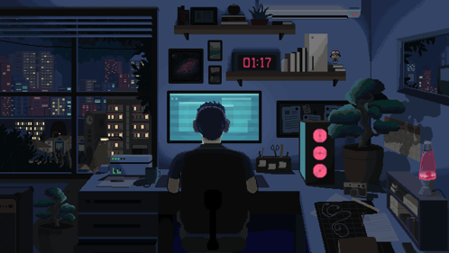

<!-- Animated Header -->

  

<!-- Coding GIF -->

  

<!-- Animated Introduction -->

  

<!-- Language and Technology Icons -->

  

 

<!-- GitHub Activity Graph -->

<!-- GitHub Contribution Snake -->

  

<!-- Animated Footer -->

  

  
<strong>GAME STATUS: STILL LEARNING. STILL BUILDING.</strong>

